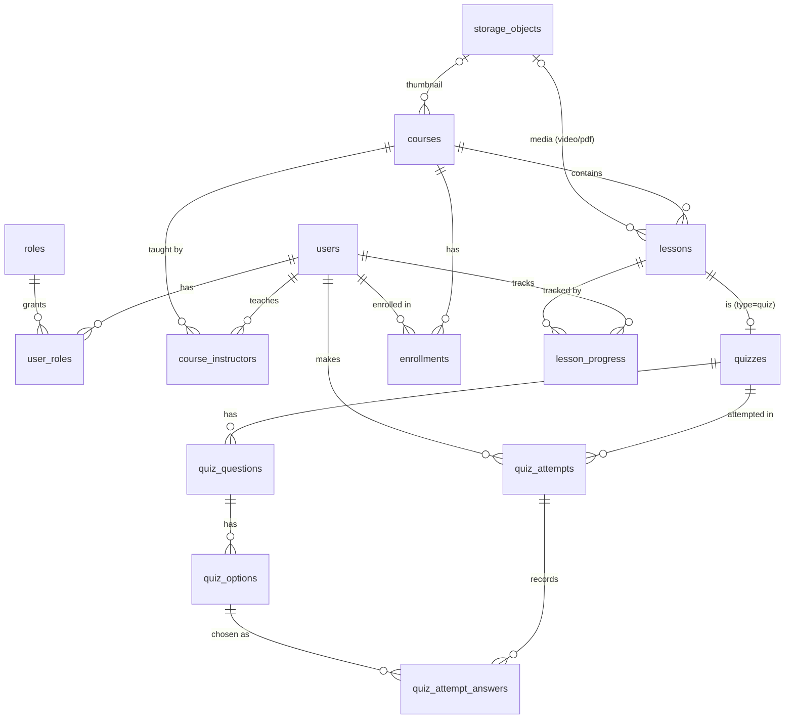

# XLearn – Cơ sở dữ liệu LMS

| File | Mục đích |
|---|---|
| `00_drop.sql` | Xóa toàn bộ schema (chỉ dùng dev/test) |
| `01_schema.sql` | Tạo bảng, ràng buộc, index, view |
| `02_seed.sql` | Dữ liệu mẫu (mật khẩu mọi tài khoản: `Password@123`) |

```bash
# Cách 1: Docker (từ thư mục backend/). Schema + seed tự chạy ở lần khởi động đầu tiên
docker compose up -d postgres
docker compose down -v && docker compose up -d postgres   # reset DB về seed ban đầu

# Cách 2: Postgres có sẵn
psql "$DATABASE_URL" -v ON_ERROR_STOP=1 -f 01_schema.sql -f 02_seed.sql
```

## ERD



## Quyết định thiết kế

- **Vai trò** tách thành `roles` + `user_roles` (n-n): thêm vai trò mới chỉ cần INSERT; một người có thể vừa dạy vừa học.
- **Quyền trên khóa học** dựa vào `course_instructors` (hỗ trợ đồng giảng dạy), không chỉ `courses.created_by`.
- **File nằm ngoài DB**: `storage_objects` chỉ lưu `provider/bucket/object_key` + metadata (MIME, dung lượng, thời lượng video, số trang PDF). Backend sinh presigned URL/CDN URL lúc runtime. Luồng upload: tạo bản ghi `pending` → client upload thẳng lên bucket bằng presigned PUT → backend xác nhận → `ready`.
- **Quiz là một loại bài học** (`lesson_type = 'quiz'`, chi tiết ở `quizzes` quan hệ 1-1) → tiến độ khóa học tính đồng nhất trên `lesson_progress`. Bài quiz được đánh dấu `completed` khi có một lượt `passed = TRUE` (logic tầng ứng dụng).
- **Xóa học viên khỏi khóa** = `enrollments.status = 'removed'` (giữ lịch sử điểm/tiến độ); thêm lại thì đổi về `active`.
- **Toàn vẹn dữ liệu bằng ràng buộc khai báo**: CHECK cho trạng thái, CHECK video/pdf bắt buộc có file, FK ghép `(option_id, question_id)` đảm bảo đáp án thuộc đúng câu hỏi.
- **Soft delete** (`deleted_at`) cho `courses`, `lessons`.

## Truy vấn theo chức năng

```sql
-- [Học viên] Danh sách khóa cần học + tiến độ
SELECT c.code, c.title, p.progress_percent, p.due_at
FROM v_enrollment_progress p JOIN courses c ON c.id = p.course_id
WHERE p.user_id = :me AND p.enrollment_status IN ('active', 'completed')
  AND c.status = 'published' AND c.deleted_at IS NULL
ORDER BY p.due_at;

-- [Học viên] Chi tiết khóa: danh sách bài + trạng thái từng bài
SELECT l.id, l.title, l.lesson_type, l.sort_order, lp.status, lp.progress_percent
FROM lessons l
LEFT JOIN lesson_progress lp ON lp.lesson_id = l.id AND lp.user_id = :me
WHERE l.course_id = :course_id AND l.status = 'published' AND l.deleted_at IS NULL
ORDER BY l.sort_order;

-- [Học viên] Chi tiết bài học: lấy object key để backend ký URL + vị trí xem dở
SELECT l.*, so.provider, so.bucket, so.object_key, so.content_type, lp.last_position_seconds, lp.last_page
FROM lessons l
LEFT JOIN storage_objects so ON so.id = l.media_object_id
LEFT JOIN lesson_progress lp ON lp.lesson_id = l.id AND lp.user_id = :me
WHERE l.id = :lesson_id;

-- [Giảng viên] Danh sách học viên của khóa + tiến độ
SELECT u.id, u.full_name, u.email, p.enrollment_status, p.progress_percent, p.last_activity_at
FROM v_enrollment_progress p JOIN users u ON u.id = p.user_id
WHERE p.course_id = :course_id AND p.enrollment_status <> 'removed';

-- [Giảng viên] Kiểm tra quyền trên khóa
SELECT 1 FROM course_instructors WHERE course_id = :course_id AND user_id = :me;
```

> **Lưu ý cho tầng ứng dụng:** "thêm lại học viên" là upsert trên `uq_enrollments_course_user`. Cú pháp upsert khác nhau giữa các DBMS (`ON CONFLICT` / `ON DUPLICATE KEY` / `MERGE`), nên để ORM xử lý, hoặc dùng SELECT rồi INSERT/UPDATE trong cùng transaction.

## Chuyển sang DBMS khác

Schema chỉ dùng SQL chuẩn: không ENUM/ARRAY/JSONB, không trigger/function/extension, CHECK thay cho ENUM, view viết bằng SQL thuần, seed tra theo khóa tự nhiên (không hard-code id). Khi chuyển chỉ cần đổi kiểu dữ liệu:

| Postgres (file này) | MySQL 8 | SQL Server | Oracle 12c+ |
|---|---|---|---|
| `BIGINT GENERATED BY DEFAULT AS IDENTITY` | `BIGINT AUTO_INCREMENT` | `BIGINT IDENTITY(1,1)` | giữ nguyên |
| `TIMESTAMP WITH TIME ZONE` | `DATETIME(6)` (lưu UTC) | `DATETIMEOFFSET` | giữ nguyên |
| `BOOLEAN` / `TRUE` | giữ nguyên (`TINYINT(1)`) | `BIT` / `1` | `NUMBER(1)` (23ai có `BOOLEAN`) |
| `TEXT` | giữ nguyên | `NVARCHAR(MAX)` | `CLOB` |
| `VARCHAR(n)` | giữ nguyên (utf8mb4) | `NVARCHAR(n)` | `VARCHAR2(n CHAR)` |
| `START TRANSACTION` | giữ nguyên | `BEGIN TRANSACTION` | bỏ (tự mở transaction) |

Cách khuyến nghị: dùng migration của ORM (SQLAlchemy + Alembic với backend FastAPI hiện tại) và coi các file SQL này là đặc tả gốc. ORM tự sinh DDL đúng phương ngữ, nên đổi DBMS gần như chỉ còn là đổi connection string.

## Hướng mở rộng (không cần sửa bảng cũ)

- Chương/mục: thêm `course_sections`, thêm cột `lessons.section_id` cho phép NULL.
- Nhiều file mỗi bài (slide, source code): bảng `lesson_attachments (lesson_id, storage_object_id)`.
- Video nhiều độ phân giải (HLS): `object_key` trỏ tới `master.m3u8`, hoặc thêm bảng `media_renditions`.
- Câu hỏi tự luận: thêm `question_type = 'text'` vào CHECK và cột `answer_text` ở bảng câu trả lời riêng.
- ID công khai không đoán được: thêm cột `public_id CHAR(36) UNIQUE` (UUID do ứng dụng sinh).
