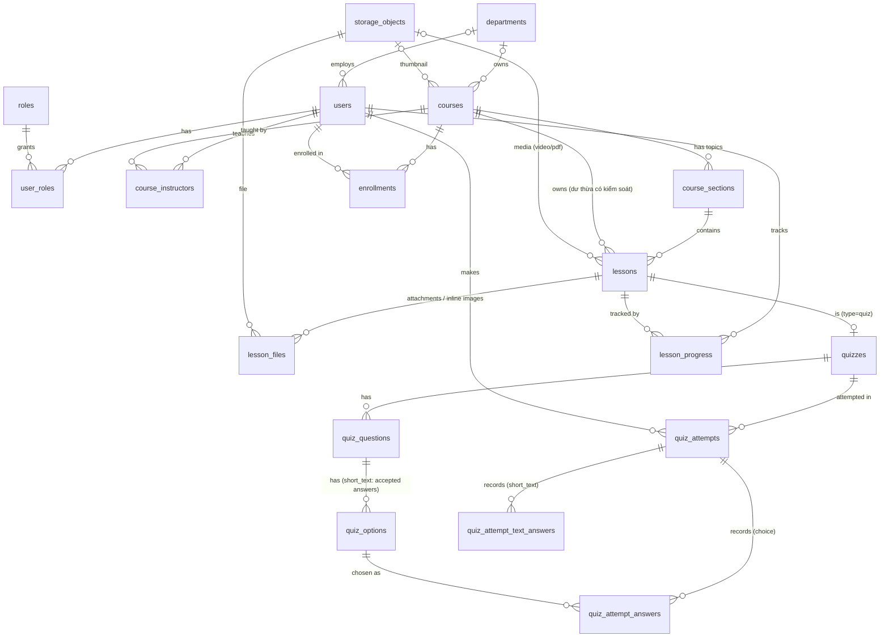

# XLearn – Cơ sở dữ liệu LMS

| File | Mục đích |
|---|---|
| `00_drop.sql` | Xóa toàn bộ schema (chỉ dùng dev/test) |
| `01_schema.sql` | Tạo bảng, ràng buộc, index, view |
| `02_seed.sql` | Dữ liệu mẫu đào tạo nội bộ nhà máy (mật khẩu mọi tài khoản: `Password@123`) |
| `03_test_accounts.sql` | Tài khoản kiểm thử cho từng tình huống (idempotent, chạy lại được) |

```bash
# Cách 1: Docker (từ thư mục backend/). Schema + seed tự chạy ở lần khởi động đầu tiên
docker compose up -d postgres
docker compose down -v && docker compose up -d postgres   # reset DB về seed ban đầu
# Thêm tài khoản kiểm thử vào DB đang chạy (không cần reset)
docker compose exec -T postgres sh -c 'psql -U "$POSTGRES_USER" -d "$POSTGRES_DB" -v ON_ERROR_STOP=1' < db/03_test_accounts.sql

# Cách 2: Postgres có sẵn
psql "$DATABASE_URL" -v ON_ERROR_STOP=1 -f 01_schema.sql -f 02_seed.sql -f 03_test_accounts.sql
```

### Dữ liệu mẫu (`02_seed.sql`)

5 phòng ban, 5 khóa học, 14 chủ đề, 28 bài học (đủ loại video / pdf / page / quiz), 5 quiz với đủ 4 dạng câu hỏi, 26 lượt ghi danh có tiến độ và lượt làm bài.

| Mã khóa | Tên | Ghi chú |
|---|---|---|
| `ATLD-01` | An toàn lao động tại khu vực sản xuất | Bắt buộc, **học tuần tự**, 5 chủ đề; bài đọc "Bảng tra PPE" có ảnh nhúng và PDF đính kèm |
| `BMTT-2026` | Bảo mật thông tin 2026 | Bắt buộc, bài kiểm tra cuối có hạn đóng 18/10 |
| `5S-01` | Quy trình 5S trong xưởng | Tự chọn; có một học viên đã bị xóa khỏi khóa (`removed`) |
| `SCC-01` | Sơ cấp cứu tại nơi làm việc | Tự chọn |
| `HC-02` | An toàn hóa chất nâng cao | Bản nháp |

| Email | Vai trò | Ghi chú |
|---|---|---|
| `admin@xlearn.dev` | admin | |
| `gv.an@xlearn.dev` | instructor, student | Phụ trách ATLD-01, 5S-01, SCC-01, HC-02; đồng giảng dạy BMTT-2026 |
| `gv.binh@xlearn.dev` | instructor | Phụ trách BMTT-2026 |
| `hv.minhanh@xlearn.dev` | student | Đang học ATLD-01 (5/11 bài, xem dở video ở 04:12, trượt quiz lượt 1) |
| `hv.tai@`, `hv.chi@`, `hv.hang@` | student | Đã hoàn thành ATLD-01 |
| `hv.mai@` | student | Chưa đăng nhập lần nào |
| `hv.cuong@`, `hv.tam@`, `hv.dung@`, `hv.giang@`, `hv.hoa@` | student | Nhiều mức tiến độ khác nhau |

### Tài khoản kiểm thử (mật khẩu `Password@123`)

| Email | Vai trò | Trạng thái | Dùng để kiểm tra |
|---|---|---|---|
| `test.hocvien@xlearn.dev` | student | active | Màn học viên khi chưa ghi danh khóa nào |
| `test.giangvien@xlearn.dev` | instructor | active | Màn giảng viên khi chưa có khóa học |
| `test.quantri@xlearn.dev` | admin, instructor | active | Vào được cả `/teach` lẫn API `/admin/users` |
| `test.tendai@xlearn.dev` | student | active | Tên rất dài: header, avatar chữ tắt, bảng |
| `test.khongvaitro@xlearn.dev` | (không có) | active | Không vai trò: API giảng viên/admin trả 403 |
| `test.bikhoa@xlearn.dev` | student | locked | Đăng nhập đúng mật khẩu vẫn bị chặn (403) |
| `test.ngunghoatdong@xlearn.dev` | student | inactive | Như trên, trạng thái vô hiệu hóa |

## ERD



## Quyết định thiết kế

- **Vai trò** tách thành `roles` + `user_roles` (n-n): thêm vai trò mới chỉ cần INSERT; một người có thể vừa dạy vừa học.
- **Quyền trên khóa học** dựa vào `course_instructors` (hỗ trợ đồng giảng dạy), không chỉ `courses.created_by`.
- **File nằm ngoài DB**: `storage_objects` chỉ lưu `provider/bucket/object_key` + metadata (MIME, dung lượng, thời lượng video, số trang PDF). Backend sinh presigned URL/CDN URL lúc runtime. Luồng upload: tạo bản ghi `pending` → client upload thẳng lên bucket bằng presigned PUT → backend xác nhận → `ready`.
- **Quiz là một loại bài học** (`lesson_type = 'quiz'`, chi tiết ở `quizzes` quan hệ 1-1) → tiến độ khóa học tính đồng nhất trên `lesson_progress`. Bài quiz được đánh dấu `completed` khi có một lượt `passed = TRUE` (logic tầng ứng dụng).
- **Xóa học viên khỏi khóa** = `enrollments.status = 'removed'` (giữ lịch sử điểm/tiến độ); thêm lại thì đổi về `active`.
- **Toàn vẹn dữ liệu bằng ràng buộc khai báo**: CHECK cho trạng thái, CHECK video/pdf bắt buộc có file, FK ghép `(option_id, question_id)` đảm bảo đáp án thuộc đúng câu hỏi.
- **Soft delete** (`deleted_at`) cho `courses`, `course_sections`, `lessons`.
- **Phòng ban** là bảng riêng (`departments`), dùng chung cho nhân viên (`users.department_id`) và đơn vị phụ trách khóa (`courses.department_id`). `users.employee_code` là UNIQUE nhưng cho phép NULL (tài khoản không phải nhân viên).
- **Chủ đề** (`course_sections`) nhóm các bài học; `lessons.sort_order` tính trong một chủ đề. `lessons` vẫn giữ `course_id` để view tiến độ và phân quyền không phải join qua chủ đề. FK ghép `(section_id, course_id)` → `course_sections (id, course_id)` đảm bảo bài học không gắn được vào chủ đề của khóa khác.
- **Học tuần tự** (`courses.is_sequential`): chủ đề sau chỉ mở khi mọi bài của chủ đề trước đã `completed` (kiểm tra ở tầng ứng dụng).
- **Hạn hoàn thành**: `courses.default_due_at` là hạn mặc định, được chép sang `enrollments.due_at` lúc ghi danh nên có thể đặt hạn riêng cho từng người.
- **Bài đọc** (`lesson_type = 'page'`) lưu Markdown ở `lessons.content`. Ảnh không nằm trong DB: upload vào `storage_objects`, gắn với bài qua `lesson_files (purpose = 'inline')` và được tham chiếu bằng ``; backend đổi `file:<id>` thành URL tạm thời lúc trả bài. Tài liệu tải về là `lesson_files (purpose = 'attachment')`.
- **Quiz luyện tập / tính điểm** (`quizzes.is_graded`); chỉ quiz tính điểm là điều kiện hoàn thành khóa. `opens_at`/`closes_at` giới hạn thời gian làm bài và là "hạn" trên dòng thời gian của học viên. `review_policy` quyết định khi nào học viên xem được đáp án (`after_submit` | `after_close` | `never`).
- **Câu tự luận ngắn** (`question_type = 'short_text'`): các dòng `quiz_options` của câu là các đáp án được chấp nhận (đều `is_correct = TRUE`), so khớp không phân biệt hoa thường và dấu; bài làm lưu ở `quiz_attempt_text_answers`.

## Truy vấn theo chức năng

```sql
-- [Học viên] Danh sách khóa cần học + tiến độ
SELECT c.code, c.title, p.progress_percent, p.due_at
FROM v_enrollment_progress p JOIN courses c ON c.id = p.course_id
WHERE p.user_id = :me AND p.enrollment_status IN ('active', 'completed')
  AND c.status = 'published' AND c.deleted_at IS NULL
ORDER BY p.due_at;

-- [Học viên] Chi tiết khóa: chủ đề → bài + trạng thái từng bài
SELECT s.id AS section_id, s.title AS section_title, s.sort_order AS section_order,
       l.id, l.title, l.lesson_type, l.sort_order, lp.status, lp.progress_percent
FROM course_sections s
JOIN lessons l ON l.section_id = s.id AND l.status = 'published' AND l.deleted_at IS NULL
LEFT JOIN lesson_progress lp ON lp.lesson_id = l.id AND lp.user_id = :me
WHERE s.course_id = :course_id AND s.deleted_at IS NULL
ORDER BY s.sort_order, l.sort_order;

-- [Học viên] Chi tiết bài học: lấy object key để backend ký URL + vị trí xem dở
SELECT l.*, so.provider, so.bucket, so.object_key, so.content_type, lp.last_position_seconds, lp.last_page
FROM lessons l
LEFT JOIN storage_objects so ON so.id = l.media_object_id
LEFT JOIN lesson_progress lp ON lp.lesson_id = l.id AND lp.user_id = :me
WHERE l.id = :lesson_id;

-- [Học viên] File của bài: ảnh nhúng (đổi file:<id> trong content) + tài liệu đính kèm
SELECT f.purpose, so.id, so.original_filename, so.content_type, so.size_bytes, so.bucket, so.object_key
FROM lesson_files f JOIN storage_objects so ON so.id = f.storage_object_id
WHERE f.lesson_id = :lesson_id
ORDER BY f.purpose, f.sort_order;

-- [Học viên] Dòng thời gian: giờ đóng quiz + hạn khóa sắp tới
SELECT 'quiz' AS kind, z.closes_at AS at, l.title, c.title AS course
FROM enrollments e JOIN courses c ON c.id = e.course_id
JOIN lessons l ON l.course_id = c.id AND l.status = 'published' AND l.deleted_at IS NULL
JOIN quizzes z ON z.lesson_id = l.id
WHERE e.user_id = :me AND e.status = 'active' AND z.closes_at >= CURRENT_TIMESTAMP
UNION ALL
SELECT 'due', e.due_at, 'Hạn hoàn thành khóa học', c.title
FROM enrollments e JOIN courses c ON c.id = e.course_id
WHERE e.user_id = :me AND e.status = 'active' AND e.due_at >= CURRENT_TIMESTAMP
ORDER BY at;

-- [Giảng viên] Danh sách học viên của khóa + tiến độ
SELECT u.id, u.full_name, u.employee_code, d.name AS department, u.email,
       p.enrollment_status, p.progress_percent, p.last_activity_at
FROM v_enrollment_progress p JOIN users u ON u.id = p.user_id
LEFT JOIN departments d ON d.id = u.department_id
WHERE p.course_id = :course_id AND p.enrollment_status <> 'removed';

-- [Giảng viên] Kiểm tra quyền trên khóa
SELECT 1 FROM course_instructors WHERE course_id = :course_id AND user_id = :me;
```

> **Lưu ý cho tầng ứng dụng:** "thêm lại học viên" là upsert trên `uq_enrollments_course_user`. Cú pháp upsert khác nhau giữa các DBMS (`ON CONFLICT` / `ON DUPLICATE KEY` / `MERGE`), nên để ORM xử lý, hoặc dùng SELECT rồi INSERT/UPDATE trong cùng transaction.

## Chuyển sang DBMS khác

Schema chỉ dùng SQL chuẩn: không ENUM/ARRAY/JSONB, không trigger/function/extension, CHECK thay cho ENUM, view viết bằng SQL thuần, seed tra theo khóa tự nhiên (không hard-code id). Khi chuyển chỉ cần đổi kiểu dữ liệu:

| Postgres (file này) | MySQL 8 | SQL Server | Oracle 12c+ |
|---|---|---|---|
| `BIGINT GENERATED BY DEFAULT AS IDENTITY` | `BIGINT AUTO_INCREMENT` | `BIGINT IDENTITY(1,1)` | giữ nguyên |
| `TIMESTAMP WITH TIME ZONE` | `DATETIME(6)` (lưu UTC) | `DATETIMEOFFSET` | giữ nguyên |
| `BOOLEAN` / `TRUE` | giữ nguyên (`TINYINT(1)`) | `BIT` / `1` | `NUMBER(1)` (23ai có `BOOLEAN`) |
| `TEXT` | giữ nguyên | `NVARCHAR(MAX)` | `CLOB` |
| `VARCHAR(n)` | giữ nguyên (utf8mb4) | `NVARCHAR(n)` | `VARCHAR2(n CHAR)` |
| `START TRANSACTION` | giữ nguyên | `BEGIN TRANSACTION` | bỏ (tự mở transaction) |

Cách khuyến nghị: dùng migration của ORM (SQLAlchemy + Alembic với backend FastAPI hiện tại) và coi các file SQL này là đặc tả gốc. ORM tự sinh DDL đúng phương ngữ, nên đổi DBMS gần như chỉ còn là đổi connection string.

## Hướng mở rộng (không cần sửa bảng cũ)

- Video nhiều độ phân giải (HLS): `object_key` trỏ tới `master.m3u8`, hoặc thêm bảng `media_renditions`.
- Tự luận dài cần giảng viên chấm tay: thêm `question_type = 'essay'`; `quiz_attempt_text_answers.is_correct` đã cho phép NULL (= chưa chấm), cần thêm cột điểm và người chấm.
- Đánh dấu sao / ẩn khóa ở màn "Khóa học của tôi": thêm `enrollments.is_starred`, `enrollments.is_hidden`.
- Video bằng đường dẫn ngoài (YouTube…): thêm `lessons.external_url` và nới `ck_lessons_media`.
- ID công khai không đoán được: thêm cột `public_id CHAR(36) UNIQUE` (UUID do ứng dụng sinh).
